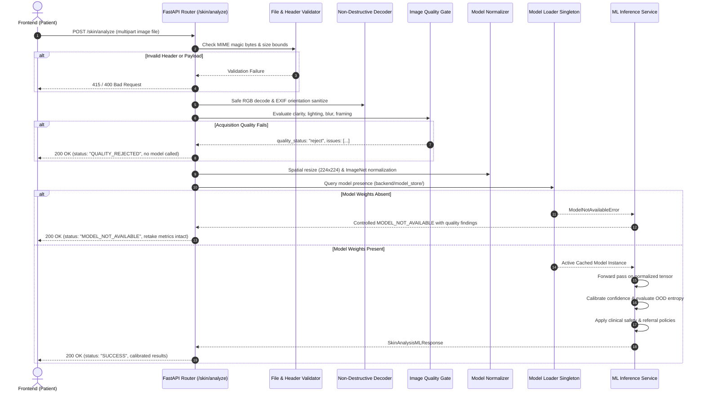

# DERMASATHIAI API Contract Specification

**Document Version:** 1.0.0  
**Target Environment:** FastAPI Backend (`/api/v1`) & React/TypeScript Client  
**Compliance Standard:** Clinical Safety Protocols & Non-Diagnostic Decision Support  

---

## 1. Executive Summary & Design Principles

The DERMASATHIAI API layer connects patient-facing client applications (Web, Mobile PWA, IVR) to clinical triage rules, non-destructive image acquisition quality gates, and forthcoming on-device/in-house machine learning services.

### Core Architecture Rules:
1. **Clinical Fail-Safe Over Fake Certainty:** When machine learning weights or inference services are absent or uncalibrated, the API strictly returns structured, non-diagnostic responses (`MODEL_NOT_AVAILABLE` or `QUALITY_REJECTED`) rather than fabricating synthetic disease classifications.
2. **Skin-Tone Equitable Acquisition:** Quality validation algorithms avoid global mean luminance thresholds to prevent bias against darker Indian Fitzpatrick skin types (Types IV–VI).
3. **Defense in Depth:** Input validation occurs at multiple tiers: MIME magic bytes check, image dimension enforcement, dynamic range evaluation, and schema validation.
4. **Data Privacy & Ephemeral Processing:** Patient biometric images are processed in volatile memory or isolated ephemeral temp files that are immediately shredded upon response delivery.

---

## 2. Global Request & Response Conventions

### Base URL:
`/api/v1`

### Standard Headers:
| Header | Required | Value / Description |
| :--- | :--- | :--- |
| `Content-Type` | Conditional | `application/json` for JSON endpoints, `multipart/form-data` for file uploads |
| `Authorization` | Conditional | `Bearer <JWT_TOKEN>` for authenticated endpoints |
| `Accept-Language` | Optional | `en`, `hi`, `mr`, `ta`, `te`, `bn` (defaults to `en`) |

### Standard Error Response Format:
```json
{
  "detail": "Human-readable clinical or operational error message",
  "error_code": "SPECIFIC_MACHINE_READABLE_CODE"
}
```

---

## 3. Detailed Endpoint Contracts

---

### 3.1 Authentication Subsystem: `POST /api/v1/auth/...`

#### Endpoints Included:
- `POST /api/v1/auth/register` — Patient/Clinician registration
- `POST /api/v1/auth/login` (or `/auth/token`) — Secure JWT authentication
- `GET /api/v1/auth/me` — Current authenticated profile

---

#### 3.1.1 `POST /api/v1/auth/register`

- **Purpose:** Create a new patient or clinician account with localized language preferences.
- **Authentication:** Public (No token required).
- **Request:**
  - **Content-Type:** `application/json`
  - **Body Schema:**
    ```json
    {
      "email": "patient@example.in",
      "password": "SecurePassword123!",
      "full_name": "Aarav Sharma",
      "preferred_language": "hi",
      "role": "patient"
    }
    ```
- **Response:**
  - **Status Code:** `201 Created`
  - **Body Schema:**
    ```json
    {
      "access_token": "eyJhbGciOiJIUzI1NiIsInR5cCI6IkpXVCJ9...",
      "token_type": "bearer",
      "user": {
        "id": "usr_94f8a1e2",
        "email": "patient@example.in",
        "full_name": "Aarav Sharma",
        "preferred_language": "hi",
        "role": "patient",
        "is_active": true
      }
    }
    ```
- **Possible Errors:**
  - `400 Bad Request`: `EMAIL_ALREADY_REGISTERED` — An account with this email exists.
  - `422 Unprocessable Entity`: Weak password or invalid email format.
- **Frontend Usage:** `AuthModal.tsx` & `api.register()`. Stores JWT in local storage (`dermasathi_token`) and hydrates `AuthContext`.
- **Current Implementation Status:** **Implemented & Active**.
- **Future Dependencies:** SMS OTP verification for low-literacy Indian mobile sign-up; ABDM (Ayushman Bharat Digital Mission) Health ID integration.

---

#### 3.1.2 `POST /api/v1/auth/login`

- **Purpose:** Authenticate credentials and issue signed JWT access tokens.
- **Authentication:** Public.
- **Request:**
  - **Content-Type:** `application/json`
  - **Body Schema:**
    ```json
    {
      "email": "patient@example.in",
      "password": "SecurePassword123!"
    }
    ```
- **Response:**
  - **Status Code:** `200 OK`
  - **Body Schema:**
    ```json
    {
      "access_token": "eyJhbGciOiJIUzI1NiIsInR5cCI6IkpXVCJ9...",
      "token_type": "bearer",
      "user": {
        "id": "usr_94f8a1e2",
        "email": "patient@example.in",
        "full_name": "Aarav Sharma",
        "preferred_language": "hi",
        "role": "patient",
        "is_active": true
      }
    }
    ```
- **Possible Errors:**
  - `401 Unauthorized`: `INVALID_CREDENTIALS` — Incorrect email or password.
  - `403 Forbidden`: `ACCOUNT_DEACTIVATED`.
- **Frontend Usage:** `AuthModal.tsx` login tab, updating user session state.
- **Current Implementation Status:** **Implemented & Active**.
- **Future Dependencies:** Refresh token rotation (`/auth/refresh`), biometric Passkeys/WebAuthn.

---

#### 3.1.3 `GET /api/v1/auth/me`

- **Purpose:** Retrieve the profile and medical preferences of the currently authenticated user.
- **Authentication:** **Bearer JWT Required**.
- **Request:**
  - **Headers:** `Authorization: Bearer <TOKEN>`
- **Response:**
  - **Status Code:** `200 OK`
  - **Body Schema:**
    ```json
    {
      "id": "usr_94f8a1e2",
      "email": "patient@example.in",
      "full_name": "Aarav Sharma",
      "preferred_language": "hi",
      "role": "patient",
      "is_active": true,
      "created_at": "2026-09-29T10:00:00Z"
    }
    ```
- **Possible Errors:**
  - `401 Unauthorized`: Token missing, expired, or signature invalid.
- **Frontend Usage:** `App.tsx` on mount to re-hydrate authentication session; `PatientProfileModule.tsx`.
- **Current Implementation Status:** **Implemented & Active**.
- **Future Dependencies:** Profile field sync with ABDM demographic registry.

---

### 3.2 Skin Condition Analysis: `POST /api/v1/skin/analyze`

- **Purpose:** Ingests dermatological photographs, runs non-destructive image acquisition quality validation, prepares standardized model tensors, and runs clinical inference with uncertainty estimation.
- **Authentication:** Optional/Supported (`Bearer <TOKEN>`). Unregistered emergency triage allowed.
- **Request:**
  - **Content-Type:** `multipart/form-data`
  - **Payload:**
    - `file` (Binary): Image payload (`.jpg`, `.jpeg`, `.png`, `.webp`). Maximum size: 10MB.
- **Clinical Lifecycle Architecture:**



- **Response:**
  - **Status Code:** `200 OK`
  
  **Case A: Acquisition Quality Rejected (Model Forward Pass Bypassed):**
  ```json
  {
    "status": "QUALITY_REJECTED",
    "prediction": null,
    "raw_probability": null,
    "calibrated_confidence": null,
    "uncertainty": null,
    "requires_professional_review": true,
    "model_version": null,
    "message": "Image acquisition check failed (excessive_blur, insufficient_lighting). Please review retake guidance.",
    "quality_assessment": {
      "quality_status": "reject",
      "issues": [
        "excessive_blur",
        "insufficient_lighting"
      ],
      "metrics": {
        "resolution": [300, 300],
        "aspect_ratio": 1.0,
        "blur_score": 18.4,
        "underexposed_pixel_ratio": 0.92,
        "overexposed_pixel_ratio": 0.0,
        "contrast_std": 3.2
      },
      "feedback_messages": [
        "Image is out of focus or blurry (score: 18.4). Hold camera steady and tap screen to focus.",
        "Image appears to have been taken in pitch darkness. Please take photo under bright ambient light."
      ]
    },
    "image_quality_gate": {
      "is_evaluated": true,
      "blur_score": 18.4,
      "illumination_score": 0.92,
      "feedback": "Image is out of focus or blurry. Take under brighter ambient light."
    },
    "ood_detection": { "is_evaluated": false, "entropy_score": null, "is_out_of_distribution": null },
    "confidence_calibration": { "is_calibrated": false, "temperature_parameter": null },
    "abstention_policy": {
      "enforced": true,
      "reason": "Inference aborted due to poor image acquisition quality."
    },
    "safety_policy": {
      "disclaimer": "DERMASATHIAI is an informational AI companion and strictly NOT a replacement for qualified doctors.",
      "referral_urgency": "routine"
    }
  }
  ```

  **Case B: Quality Passes, Model Deployment Pending in `model_store/`:**
  ```json
  {
    "status": "MODEL_NOT_AVAILABLE",
    "prediction": null,
    "raw_probability": null,
    "calibrated_confidence": null,
    "uncertainty": null,
    "requires_professional_review": true,
    "model_version": null,
    "message": "Trained skin model is not deployed in backend/model_store/. Clinical fail-safe abstention enforced. Please consult a qualified dermatologist.",
    "quality_assessment": {
      "quality_status": "pass",
      "issues": [],
      "metrics": {
        "resolution": [1080, 1080],
        "aspect_ratio": 1.0,
        "blur_score": 342.1,
        "underexposed_pixel_ratio": 0.04,
        "overexposed_pixel_ratio": 0.01,
        "contrast_std": 58.7
      },
      "feedback_messages": [
        "Image acquisition quality satisfies clinical safety criteria."
      ]
    },
    "image_quality_gate": {
      "is_evaluated": true,
      "blur_score": 342.1,
      "illumination_score": 0.04,
      "feedback": "Acquisition verified."
    },
    "ood_detection": { "is_evaluated": false, "entropy_score": null, "is_out_of_distribution": null },
    "confidence_calibration": { "is_calibrated": false, "temperature_parameter": null },
    "abstention_policy": {
      "enforced": true,
      "reason": "Model weights pending in backend/model_store/."
    },
    "safety_policy": {
      "disclaimer": "DERMASATHIAI is an informational AI companion and strictly NOT a replacement for qualified doctors.",
      "referral_urgency": "routine"
    }
  }
  ```

- **Possible Errors:**
  - `400 Bad Request`: Empty payload, corrupt stream, or zero-byte upload.
  - `413 Request Entity Too Large`: File exceeds 10MB limit.
  - `415 Unsupported Media Type`: Non-image file provided (e.g. PDF, executable).
  - `500 Internal Server Error`: Critical unexpected system exception (stack traces suppressed).
- **Frontend Usage:** `SkinAnalysisModule.tsx` via `api.analyzeSkinWithMLService()`. Powers image preview, inline quality badge, retake advice cards, and uncertainty indicators.
- **Current Implementation Status:** **Preprocessing & Quality Gate Active | Model Integration Pending**.
- **Future Dependencies:** Trained ONNX / PyTorch model artifact deployed to `backend/model_store/` by ML engineering.

---

### 3.3 Symptom Triage Analysis: `POST /api/v1/symptoms/analyze`

*(Currently served via `/api/v1/symptoms/check` with planned alias `/symptoms/analyze`)*

- **Purpose:** Evaluates self-reported patient symptoms, duration, systemic red flags (high fever, rapid spreading, mucosal involvement), and maps to urgency tiers.
- **Authentication:** Public or Bearer JWT.
- **Request:**
  - **Content-Type:** `application/json`
  - **Body Schema:**
    ```json
    {
      "symptoms": ["intense_itching", "erythema", "scaling"],
      "duration_days": 4,
      "severity": "moderate",
      "has_fever": false,
      "has_rapid_spread": false,
      "has_pain_or_bleeding": false,
      "language": "hi"
    }
    ```
- **Response:**
  - **Status Code:** `200 OK`
  - **Body Schema:**
    ```json
    {
      "assessment_id": "sym_71c2b9a4",
      "urgency_level": "routine",
      "is_emergency": false,
      "emergency_flags": [],
      "possible_patterns": [
        {
          "name": "Contact Dermatitis / Eczema Pattern",
          "match_confidence": "moderate",
          "description": "Localized inflammatory response commonly triggered by external allergens or irritants."
        }
      ],
      "recommended_action": "Consult a primary healthcare provider or dermatologist within 3–5 days.",
      "home_care_precautions": [
        "Avoid scratching the affected area to prevent secondary bacterial infection.",
        "Use mild, fragrance-free bathing soaps and apply bland emollients."
      ],
      "red_flag_warnings": [
        "Seek immediate emergency care if you experience breathing difficulty, facial swelling, or spreading blisters."
      ],
      "disclaimer": "This symptom assessment is assistive and does not provide an official clinical diagnosis."
    }
    ```
- **Possible Errors:**
  - `422 Unprocessable Entity`: Missing required `symptoms` array or invalid duration.
- **Frontend Usage:** `SymptomCheckerModule.tsx` via `api.checkSymptoms()`. Dynamically switches UI to emergency banner when `is_emergency: true`.
- **Current Implementation Status:** **Implemented & Active** (Rule-based clinical triage engine).
- **Future Dependencies:** LLM-assisted conversational clarifying questions; multi-turn differential triage engine.

---

### 3.4 Medical Report OCR & Structured Extraction: `POST /api/v1/reports/analyze`

- **Purpose:** Ingests photos or scans of laboratory reports, pathology slides, or biopsy documents, extracts clinical text via Optical Character Recognition (OCR), and parses key bio-markers (e.g., IgE, ESR, skin biopsy histopathology findings).
- **Authentication:** **Bearer JWT Required** (Protects sensitive patient diagnostic records).
- **Request:**
  - **Content-Type:** `multipart/form-data`
  - **Payload:**
    - `file` (Binary): PDF document or high-resolution scan (`.pdf`, `.png`, `.jpg`).
    - `report_type` (String, Optional): `"dermatopathology"`, `"blood_panel"`, `"allergy_panel"`, `"general"`.
    - `language` (String, Optional): `"en"`, `"hi"`.
- **Response:**
  - **Status Code:** `200 OK` (Contract Specification)
  - **Body Schema:**
    ```json
    {
      "status": "PROCESSED",
      "document_type": "allergy_panel",
      "extracted_text_snippet": "Serum Total IgE: 420 IU/mL (Reference: <100 IU/mL)...",
      "extracted_markers": [
        {
          "marker_name": "Serum Total IgE",
          "value": 420.0,
          "unit": "IU/mL",
          "reference_range": "< 100 IU/mL",
          "status": "elevated",
          "clinical_significance": "Often correlated with atopic dermatitis or active allergic responses."
        }
      ],
      "key_findings_summary": "Elevated IgE level suggests atopic diathesis. No malignant features reported.",
      "questions_for_doctor": [
        "Should I undergo specific patch or skin-prick testing for environmental allergens?",
        "Are topical calcineurin inhibitors appropriate given recurrent atopic flares?"
      ],
      "requires_physician_review": true,
      "disclaimer": "OCR and automated report summaries may misread values. Always provide original physical reports to your doctor."
    }
    ```
- **Possible Errors:**
  - `400 Bad Request`: `CORRUPT_DOCUMENT_PAYLOAD` — Unreadable PDF or corrupted image.
  - `413 Request Entity Too Large`: Exceeds 15MB document limit.
  - `503 Service Unavailable`: `OCR_SERVICE_UNAVAILABLE` — Model integration pending.
- **Frontend Usage:** `MedicalReportsModule.tsx`. Provides upload dropzone, OCR text preview, biomarker table, and doctor consultation questions checklist.
- **Current Implementation Status:** **Model Integration Pending** (Contract defined; awaiting OCR model and medical NER parser integration).
- **Future Dependencies:** Localized PaddleOCR / Tesseract OCR engine, BioBERT / Med-Spacy clinical entity extraction models.

---

### 3.5 Prescription OCR & Schedule Analysis: `POST /api/v1/prescriptions/analyze`

- **Purpose:** Digitizes handwritten or printed doctor prescriptions, deciphers medication names, dosages, frequencies, and durations, and checks for potential drug conflicts against patient profile.
- **Authentication:** **Bearer JWT Required**.
- **Request:**
  - **Content-Type:** `multipart/form-data`
  - **Payload:**
    - `file` (Binary): Photograph of prescription (`.jpg`, `.png`).
    - `patient_allergies` (String, Optional JSON Array): e.g. `["penicillin", "sulfa"]`.
- **Response:**
  - **Status Code:** `200 OK` (Contract Specification)
  - **Body Schema:**
    ```json
    {
      "status": "PARSED",
      "prescribed_medications": [
        {
          "name": "Hydroxyzine Hydrochloride",
          "dosage": "25 mg",
          "frequency": "Once daily at bedtime",
          "duration": "7 days",
          "route": "oral",
          "purpose": "Anti-histamine for nocturnal pruritus (itching)",
          "warnings": ["May cause drowsiness. Avoid driving or operating machinery."]
        },
        {
          "name": "Mometasone Furoate 0.1% Cream",
          "dosage": "Thin application",
          "frequency": "Once daily at night",
          "duration": "14 days",
          "route": "topical",
          "purpose": "Medium-potency corticosteroid for inflammatory rash",
          "warnings": ["Do not apply on open infected lesions or facial eyelids without specific instruction."]
        }
      ],
      "dosage_schedule": [
        {
          "time_of_day": "Night",
          "medication": "Hydroxyzine 25mg & Mometasone cream application"
        }
      ],
      "safety_alerts": [],
      "requires_pharmacist_verification": true,
      "disclaimer": "Prescription digitization is assistive. Always follow the handwritten physical prescription and your pharmacist's guidance."
    }
    ```
- **Possible Errors:**
  - `400 Bad Request`: Blurry or unreadable handwriting.
  - `422 Unprocessable Entity`: Illegible doctor signature or unidentifiable drug abbreviations.
  - `503 Service Unavailable`: `PRESCRIPTION_ENGINE_OFFLINE` — Model integration pending.
- **Frontend Usage:** `PrescriptionModule.tsx`. Visualizes daily dosage timetable, alarm reminders, and warnings.
- **Current Implementation Status:** **Model Integration Pending** (Contract defined; awaiting handwritten text recognition HTR model).
- **Future Dependencies:** TrOCR / Handwriting Recognition Model fine-tuned on Indian doctor prescription datasets; Indian Central Drug Standard Control Organization (CDSCO) formulary database.

---

### 3.6 Medication Safety & Drug Interactions: `POST /api/v1/medicines/interactions`

*(Currently served via `/api/v1/medications/check-safety` with planned alias `/medicines/interactions`)*

- **Purpose:** Cross-checks patient medication lists for dangerous interactions, systemic contraindications, and pregnancy/lactation warnings.
- **Authentication:** Public or Bearer JWT.
- **Request:**
  - **Content-Type:** `application/json`
  - **Body Schema:**
    ```json
    {
      "medications": ["Isotretinoin", "Doxycycline"],
      "allergies": [],
      "patient_conditions": ["acne_vulgaris"],
      "is_pregnant_or_planning": false,
      "language": "en"
    }
    ```
- **Response:**
  - **Status Code:** `200 OK`
  - **Body Schema:**
    ```json
    {
      "safety_status": "DANGEROUS_INTERACTION",
      "has_contraindications": true,
      "severity_score": "high",
      "flagged_interactions": [
        {
          "drug_a": "Isotretinoin",
          "drug_b": "Doxycycline",
          "severity": "CONTRAINDICATED",
          "clinical_risk": "Pseudotumor Cerebri (Benign Intracranial Hypertension)",
          "mechanism": "Concomitant use of systemic retinoids and tetracyclines significantly increases intracranial pressure.",
          "recommendation": "DO NOT TAKE TOGETHER. Contact your dermatologist immediately to adjust therapy."
        }
      ],
      "pregnancy_category_warnings": [
        {
          "medication": "Isotretinoin",
          "category": "Category X (Teratogenic)",
          "warning": "Strictly contraindicated during pregnancy. Causes severe fetal abnormalities."
        }
      ],
      "safe_usage_instructions": [
        "Take oral retinoids with meals containing dietary fats to ensure consistent absorption."
      ],
      "disclaimer": "Interaction checks are based on standard clinical pharmacopeias and do not replace personalized doctor advice."
    }
    ```
- **Possible Errors:**
  - `400 Bad Request`: Medication name unparseable or unrecognized in drug registry.
- **Frontend Usage:** `MedicationSafetyModule.tsx` via `api.checkMedications()`. Renders high-visibility red alerts when severe contraindications are detected.
- **Current Implementation Status:** **Implemented & Active** (Core clinical safety database).
- **Future Dependencies:** Real-time Indian Jan Aushadhi generic equivalent mapping; National Formulary of India (NFI) drug index expansion.

---

### 3.7 Voice Query Transcription: `POST /api/v1/voice/transcribe`

- **Purpose:** Accepts spoken audio recordings in Hindi, Marathi, Tamil, Telugu, Bengali, or Indian English, transcribes spoken vernacular into text, and detects clinical intention for low-literacy users.
- **Authentication:** Public or Bearer JWT.
- **Request:**
  - **Content-Type:** `multipart/form-data`
  - **Payload:**
    - `audio_file` (Binary): Audio payload (`.webm`, `.wav`, `.m4a`, `.mp3`). Max size: 5MB.
    - `target_language` (String, Optional): `"hi"`, `"en"`, `"auto"`.
- **Response:**
  - **Status Code:** `200 OK` (Contract Specification)
  - **Body Schema:**
    ```json
    {
      "status": "TRANSCRIBED",
      "language_detected": "hi",
      "transcribed_text": "मेरे हाथ पर दो दिन से बहुत खुजली और लाल दाने हो रहे हैं",
      "english_translation": "I have been having intense itching and red bumps on my hand for two days",
      "extracted_entities": {
        "symptoms": ["itching", "red_bumps"],
        "body_location": "hand",
        "duration": "2 days"
      },
      "confidence": 0.94,
      "audio_duration_seconds": 3.8
    }
    ```
- **Possible Errors:**
  - `400 Bad Request`: `AUDIO_INCOMPREHENSIBLE` — Background noise or clipping prevented speech decoding.
  - `415 Unsupported Media Type`: Unsupported audio codec.
  - `503 Service Unavailable`: `VOICE_ENGINE_OFFLINE` — Model integration pending.
- **Frontend Usage:** Microphone recording button embedded in `Navbar.tsx`, `SymptomCheckerModule.tsx`, and mobile voice assistant interface.
- **Current Implementation Status:** **Model Integration Pending** (Contract defined; awaiting Indian multilingual Whisper / AI4Bharat IndicWhisper integration).
- **Future Dependencies:** AI4Bharat IndicWhisper or Whisper-large-v3 quantized on-premise engine.

---

### 3.8 System Health & Model Telemetry: `GET /api/v1/health`

*(Served at `/api/v1/health/status` with alias `/health`)*

- **Purpose:** Delivers operational uptime status, database connectivity, model store artifact presence, and active safety gates for monitoring and load balancers.
- **Authentication:** Public (No token required).
- **Request:**
  - **Headers:** None required.
- **Response:**
  - **Status Code:** `200 OK`
  - **Body Schema:**
    ```json
    {
      "status": "online",
      "service": "DERMASATHIAI",
      "environment": "development",
      "database": "healthy",
      "ml_subsystem": {
        "model_path": "backend/model_store/v1.0.0/model.onnx",
        "weights_loaded": false,
        "status_message": "Pending Model Deployment in backend/model_store/"
      },
      "quality_gate_active": true,
      "safety_layer_active": true
    }
    ```
- **Possible Errors:**
  - `503 Service Unavailable`: Database unreachable or core service crash.
- **Frontend Usage:** `Navbar.tsx` (system health status indicator) and `OfflineState.tsx` to detect service recovery.
- **Current Implementation Status:** **Implemented & Active**.
- **Future Dependencies:** Prometheus telemetry metrics scrape endpoint (`/metrics`).

---

## 4. Summary Matrix: Implementation Status & Dependencies

| Endpoint | Method | Status | Auth Required | Core Dependency |
| :--- | :--- | :--- | :--- | :--- |
| `/api/v1/auth/register` | `POST` | **Active** | No | PostgreSQL / SQLite User table |
| `/api/v1/auth/login` | `POST` | **Active** | No | Password hashing (bcrypt) & JWT engine |
| `/api/v1/auth/me` | `GET` | **Active** | Yes | JWT Bearer verification |
| `/api/v1/skin/analyze` | `POST` | **Active Quality Gate** *(Model Pending)* | No | Preprocessing pipeline, `model_store/` ONNX weights |
| `/api/v1/symptoms/analyze` | `POST` | **Active** | No | Clinical rule-based emergency triage service |
| `/api/v1/reports/analyze` | `POST` | **Model Pending** | Yes | PaddleOCR / Tesseract & BioBERT NER model |
| `/api/v1/prescriptions/analyze` | `POST` | **Model Pending** | Yes | TrOCR handwriting recognition model |
| `/api/v1/medicines/interactions`| `POST` | **Active** | No | Clinical pharmacopeia & interaction rule matrix |
| `/api/v1/voice/transcribe` | `POST` | **Model Pending** | No | Multilingual speech-to-text (IndicWhisper) |
| `/api/v1/health` | `GET` | **Active** | No | Database connection ping & model loader registry |

---

## 5. Security & Clinical Disclaimer Notice

> **CLINICAL NOTICE:**  
> The DERMASATHIAI API is architected strictly as a clinical decision-support and triage companion. None of the endpoints constitute formal telemedicine diagnoses. Under no circumstances should frontend clients render probabilistic AI predictions as medical certainties. All outputs must present mandatory clinical referrals and emergency hotlines.
