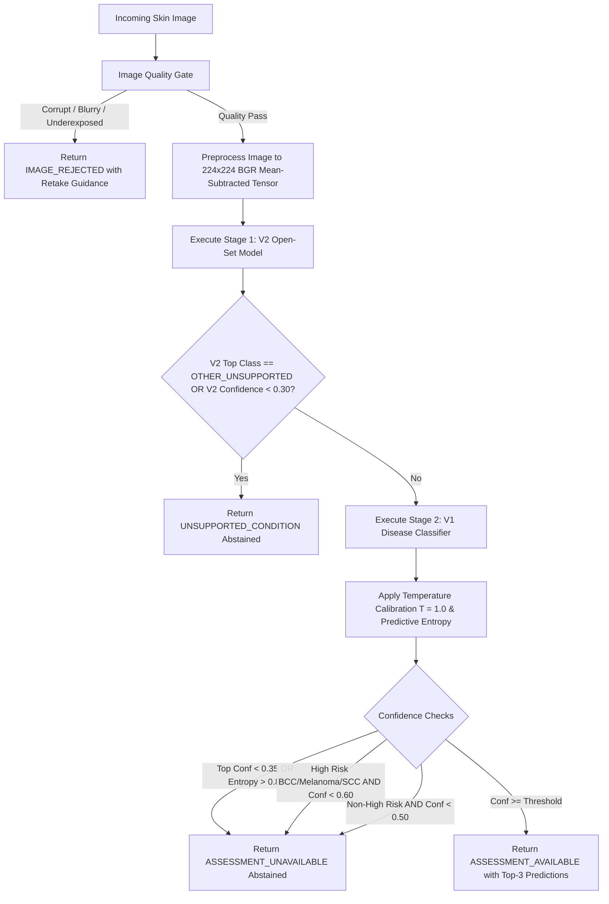

# Model Integration Audit: DERMASATHIAI & Trained Skin AI Repository

**Document Version:** 1.0.0  
**Audit Date:** 2026-09-30  
**Target Repository:** [Primordial-Creater/DermaSathiAI](https://github.com/Primordial-Creater/DermaSathiAI)  
**Status:** Audit Completed — Staging / Pre-Integration Phase (No code modified, no dummy weights created)

---

## Executive Summary

This audit assesses the compatibility, architecture, and deployment requirements between the current active **DERMASATHIAI** production codebase and the friend's trained deep-learning repository (**`Primordial-Creater/DermaSathiAI`**). 

The friend's repository contains a completed, production-structured **Two-Stage Dual-Model Skin AI Pipeline** built on **TensorFlow / Keras 3** utilizing **ResNet50** backbones with Git LFS-stored `.keras` artifacts (~277 MB each). In contrast, the current local application codebase is structured around a clinical safety triage architecture with modular quality-gating and stubs originally staged for an ONNX runtime (`backend/model_store/v1.0.0/model.onnx`).

This document provides a factual, non-speculative blueprint detailing both codebases, model specifications, preprocessing pipelines, class mappings, deployment footprints, and technical integration risks.

---

## 1. Existing Application Architecture (Local DERMASATHIAI)

### 1.1 Frontend Framework & Entry Points
- **Framework & Core Tech:** React 18.2, TypeScript 5, Vite 5.4.
- **Entry Points:**
  - HTML Root: [`frontend/index.html`](file:///c:/Users/ARPIT%20SAINI/Desktop/Derma%20Sathi/frontend/index.html)
  - Application Bootstrap: [`frontend/src/main.tsx`](file:///c:/Users/ARPIT%20SAINI/Desktop/Derma%20Sathi/frontend/src/main.tsx)
  - Main App & Navigation Router: [`frontend/src/App.tsx`](file:///c:/Users/ARPIT%20SAINI/Desktop/Derma%20Sathi/frontend/src/App.tsx)
- **Styling System:** Vanilla CSS design tokens with custom HSL variables, glassmorphism, responsive cards, and dark/light support in [`frontend/src/index.css`](file:///c:/Users/ARPIT%20SAINI/Desktop/Derma%20Sathi/frontend/src/index.css).
- **Internationalization:** Multi-language localization (English and Hindi) via `i18next` and `react-i18next` with JSON resource dictionaries in [`frontend/src/i18n/translations/`](file:///c:/Users/ARPIT%20SAINI/Desktop/Derma%20Sathi/frontend/src/i18n/translations/).
- **API Client:** [`frontend/src/services/api.ts`](file:///c:/Users/ARPIT%20SAINI/Desktop/Derma%20Sathi/frontend/src/services/api.ts), exposing strongly-typed wrapper methods over `fetch()` with automatic `Authorization: Bearer <token>` and `Accept-Language` headers.

### 1.2 Backend Framework & Entry Points
- **Framework:** FastAPI (Python 3.13), Uvicorn ASGI server.
- **Entry Point:** [`backend/app/main.py`](file:///c:/Users/ARPIT%20SAINI/Desktop/Derma%20Sathi/backend/app/main.py) with lifespan database schema synchronization (`Base.metadata.create_all`).
- **Configuration & Security:**
  - [`backend/app/core/config.py`](file:///c:/Users/ARPIT%20SAINI/Desktop/Derma%20Sathi/backend/app/core/config.py) using `pydantic-settings.BaseSettings`, reading `.env`.
  - JWT Bearer Authentication (OAuth2PasswordBearer, HS256, bcrypt).
  - SQLite database via SQLAlchemy ORM ([`backend/app/db/session.py`](file:///c:/Users/ARPIT%20SAINI/Desktop/Derma%20Sathi/backend/app/db/session.py)).
- **Existing API Router Structure:** Mounted under `/api/v1` via [`backend/app/api/v1/router.py`](file:///c:/Users/ARPIT%20SAINI/Desktop/Derma%20Sathi/backend/app/api/v1/router.py):
  1. `/api/v1/health`: System health and status telemetry.
  2. `/api/v1/auth`: Patient signup, authentication, profile management.
  3. `/api/v1/skin`: Clean ML inference service endpoint ([`skin.py`](file:///c:/Users/ARPIT%20SAINI/Desktop/Derma%20Sathi/backend/app/api/v1/endpoints/skin.py)).
  4. `/api/v1/skin-analysis`: 8-stage clinical skin pipeline with consultation audit logging ([`skin_analysis.py`](file:///c:/Users/ARPIT%20SAINI/Desktop/Derma%20Sathi/backend/app/api/v1/endpoints/skin_analysis.py)).
  5. `/api/v1/reports`: Multimodal medical lab report & biopsy analysis via Google Gemini.
  6. `/api/v1/prescriptions`: Doctor prescription OCR, patient verification, and daily adherence reminder scheduler.
  7. `/api/v1/symptoms`, `/api/v1/medications`, `/api/v1/wellness`, `/api/v1/emergency`, `/api/v1/healthcare-access`.

### 1.3 Upload & File Handling
- Handled via FastAPI `UploadFile = File(...)`.
- Maximum upload size strictly enforced at **10 MB** (`settings.MAX_UPLOAD_SIZE_BYTES`).
- Supported MIME types: `image/jpeg`, `image/png`, `image/webp`.
- **Security Pattern:** In [`skin.py`](file:///c:/Users/ARPIT%20SAINI/Desktop/Derma%20Sathi/backend/app/api/v1/endpoints/skin.py), files are processed through isolated temporary files (`tempfile.NamedTemporaryFile`) and guaranteed deletion via `finally: os.remove()`. In [`skin_analysis.py`](file:///c:/Users/ARPIT%20SAINI/Desktop/Derma%20Sathi/backend/app/api/v1/endpoints/skin_analysis.py), in-memory bytes are parsed without saving raw patient photos to disk.

### 1.4 Existing AI & Skin Analysis Code
- **Image Quality Gate Subsystem:** [`backend/app/ml/preprocessing/`](file:///c:/Users/ARPIT%20SAINI/Desktop/Derma%20Sathi/backend/app/ml/preprocessing/) contains:
  - `validator.py`: Magic byte and extension verification.
  - `decoder.py`: Safe OpenCV/Pillow image decoding with EXIF orientation correction.
  - `quality.py`: Evaluates Laplacian blur variance (threshold 60.0), underexposure/overexposure, and resolution.
  - `normalizer.py`: Configurable spatial resizing and tensor layout formatting (`NCHW` vs `NHWC`).
- **Current Model Loader Staging:** [`backend/app/ml/model_loader.py`](file:///c:/Users/ARPIT%20SAINI/Desktop/Derma%20Sathi/backend/app/ml/model_loader.py) and [`backend/app/services/skin_pipeline/inference_engine.py`](file:///c:/Users/ARPIT%20SAINI/Desktop/Derma%20Sathi/backend/app/services/skin_pipeline/inference_engine.py) implement fail-safe singletons that catch missing weights and safely abstain with `MODEL_NOT_AVAILABLE` instead of crashing.

---

## 2. GitHub Trained Model Repository Inspection

**Repository:** `https://github.com/Primordial-Creater/DermaSathiAI`  
**Git Head Commit:** `011298235e39b8686a3fd7556f20ff2206b750f9`  
**Repository Architecture:** Two-Stage Dual-Model Classification & Clinical Safety Pipeline with optional Gemini hybrid fallback.

### 2.1 Model Framework & Formats
- **Framework:** **TensorFlow / Keras 3** (`keras_version: 3.15.1`, `tensorflow>=2.15.0`).
- **File Format:** Modern Keras zip archive format (`.keras`), containing:
  - `config.json`: Model topology and layer hyperparameters.
  - `metadata.json`: Keras version (`3.15.1`) and serialization timestamp.
  - `model.weights.h5`: HDF5 serialized trained layer weights.
- **Git LFS Tracked:** Both model artifacts are tracked via Git Large File Storage (`.gitattributes`).

### 2.2 Exact Model Architecture

Both models utilize identical backbone and head topology, differing only in the final output classification layer:

```
[Input Layer: Tensor shape (None, 224, 224, 3), float32]
                         │
                         ▼
[Backbone: ResNet50 Functional CNN (175 layers, ImageNet Pretrained)]
  - Frozen early stages, fine-tuned from conv4_block1_1_conv
                         │
                         ▼
[GlobalAveragePooling2D: Output shape (None, 2048)]
                         │
                         ▼
[Dropout: rate = 0.30]
                         │
                         ▼
[Dense Layer: 256 units, ReLU activation]
                         │
                         ▼
[Dropout: rate = 0.30]
                         │
                         ▼
[Dense Output Layer: Softmax activation]
  - V1 Disease Classifier: 14 units
  - V2 Open-Set Gating Classifier: 15 units
```

### 2.3 Model File & Artifact Details

| Artifact | File Path in Repo | File Size | Git LFS SHA-256 Hash | Purpose |
|---|---|---|---|---|
| **V1 Disease Classifier** | `backend/models/skin_ai/v1_disease/model.keras` | **277,735,550 bytes** (~264.87 MB) | `1efc583caaffccfa67aaa69fa43975d3b25056715994244777c90a0f93f81b45` | Categorizes image across 14 dermatological disease categories |
| **V2 Open-Set Gating** | `backend/models/skin_ai/v2_open_set/model.keras` | **277,738,634 bytes** (~264.87 MB) | `671f43bdb08f17eb0bbc6846ac17a0c7c316d1c950594debe7631569cbb61a76` | Detects out-of-distribution / unsupported conditions (`OTHER_UNSUPPORTED`) |
| **V1 Class Map** | `backend/models/skin_ai/v1_disease/class_mapping.json` | 347 bytes | Plain JSON | Integer index (str) → Class name mapping |
| **V2 Class Map** | `backend/models/skin_ai/v2_open_set/class_mapping.json` | 345 bytes | Plain JSON | Class name → Integer index mapping |
| **Skin Policy** | `backend/models/skin_ai/skin_ai_policy.json` | 728 bytes | Plain JSON | Operating thresholds, high-risk flags, temperatures |
| **Disease Profiles** | `backend/models/skin_ai/recommendations/skin_disease_profiles.json` | 13,819 bytes | Plain JSON | Clinical summaries, red flags, and non-prescriptive lifestyle guidance for all 14 conditions |

---

## 3. Input & Preprocessing Specifications

### 3.1 Input Requirements
- **Spatial Resolution:** **224 × 224 pixels** (`MODEL_INPUT_SIZE = 224`).
- **Channel Format:** **3 channels (RGB source, converted to BGR for ResNet50)**.
- **Batch Tensor Shape:** **`(1, 224, 224, 3)`** in standard TensorFlow channel-last (`NHWC`) layout.

### 3.2 Preprocessing & Normalization Flow
Implemented in `backend/app/ml/skin/resnet_preprocess.py`:
1. **Color Space Enforcement:** Convert source image to standard RGB (`Image.convert('RGB')`).
2. **Resizing:** Bilinear interpolation to `(224, 224)`.
3. **Float Conversion:** Raw uint8 `[0, 255]` is converted to float32 `[0.0, 255.0]` (note: **not** divided by 255.0).
4. **ResNet50 Mean Subtraction (`tf.keras.applications.resnet50.preprocess_input`):**
   - Transposes channel order from RGB to **BGR**.
   - Subtracts ImageNet channel means:
     - $B \leftarrow B - 103.939$
     - $G \leftarrow G - 116.779$
     - $R \leftarrow R - 123.680$
5. **Batch Expansion:** `np.expand_dims(arr, axis=0)` yielding `(1, 224, 224, 3)`.

---

## 4. Class Label & Mapping Specifications

### 4.1 V1 Disease Classifier (14 Classes)
From `backend/models/skin_ai/v1_disease/class_mapping.json`:

| Index | Canonical Class Name | Clinical Category | High Risk Flag |
|---|---|---|---|
| `0` | **Actinic keratoses** | Precancerous | False |
| `1` | **Basal cell carcinoma** | Malignant Skin Cancer | **True** |
| `2` | **Benign keratosis-like lesions** | Benign Lesion | False |
| `3` | **Chickenpox** | Infectious Viral Rash | False |
| `4` | **Cowpox** | Infectious Viral Rash | False |
| `5` | **Dermatofibroma** | Benign Fibrous Nodule | False |
| `6` | **HFMD** (Hand-foot-and-mouth disease) | Infectious Viral Rash | False |
| `7` | **Healthy** | Normal Skin | False |
| `8` | **Measles** | Infectious Viral Exanthem | False |
| `9` | **Melanocytic nevi** | Benign Mole | False |
| `10` | **Melanoma** | Malignant Skin Cancer | **True** |
| `11` | **Monkeypox** | Infectious Viral Lesion | False |
| `12` | **Squamous cell carcinoma** | Malignant Skin Cancer | **True** |
| `13` | **Vascular lesions** | Vascular Anomaly / Angioma | False |

### 4.2 V2 Open-Set Gating Classifier (15 Classes)
From `backend/models/skin_ai/v2_open_set/class_mapping.json`:

| Class Name | Index | Role |
|---|---|---|
| `Actinic keratoses` | 0 | Supported class candidate |
| `Basal cell carcinoma` | 1 | Supported class candidate |
| `Benign keratosis-like lesions` | 2 | Supported class candidate |
| `Chickenpox` | 3 | Supported class candidate |
| `Cowpox` | 4 | Supported class candidate |
| `Dermatofibroma` | 5 | Supported class candidate |
| `HFMD` | 6 | Supported class candidate |
| `Healthy` | 7 | Supported class candidate |
| `Measles` | 8 | Supported class candidate |
| `Melanocytic nevi` | 9 | Supported class candidate |
| `Melanoma` | 10 | Supported class candidate |
| `Monkeypox` | 11 | Supported class candidate |
| **`OTHER_UNSUPPORTED`** | **12** | **Out-of-Distribution Gating Target** |
| `Squamous cell carcinoma` | 13 | Supported class candidate |
| `Vascular lesions` | 14 | Supported class candidate |

---

## 5. Inference Flow & Decision Logic

The complete inference flow in `backend/app/ml/skin/dual_model_pipeline.py` operates as follows:



### Safety Policies & Thresholds:
- **`V2_MIN_ACCEPT_PROBABILITY` = 0.30**: If the open-set model cannot identify a known category with at least 30% confidence or identifies `OTHER_UNSUPPORTED`, the pipeline abstains immediately.
- **`ABSOLUTE_ABSTENTION_THRESHOLD` = 0.35**: Any prediction below 35% confidence is rejected.
- **`MAX_ENTROPY_THRESHOLD` = 0.80**: Normalised predictive entropy above 0.80 indicates conflicting probability mass across multiple classes; triggers abstention.
- **`HIGH_RISK_CONFIDENCE_THRESHOLD` = 0.60**: Malignancies (Melanoma, BCC, SCC) require at least 60% confidence before displaying assessment availability; otherwise, triggers conservative referral abstention.

---

## 6. Dependency & Runtime Analysis

### 6.1 GitHub Repository Requirements (`backend/requirements/ml.txt`)
- `tensorflow>=2.15.0`
- `tensorflow-hub>=0.16.0`
- `Pillow>=10.0.0`
- `opencv-python-headless>=4.8.0`
- `scikit-image>=0.22.0`
- `scikit-learn>=1.3.0`
- `numpy>=1.24.0`
- `pandas>=2.0.0`
- `scipy>=1.11.0`
- `PyYAML>=6.0`
- `pydantic>=2.0.0`

### 6.2 Comparison with Local Production Requirements
- **Current Local Backend Dependencies (`backend/requirements.txt`):**
  - `fastapi`, `uvicorn`, `pydantic`, `pydantic-settings`, `sqlalchemy`, `pillow`, `numpy`, `opencv-python-headless`, `httpx`.
  - **Does NOT include:** `tensorflow` or `keras`.

---

## 7. File Classification: Deployment vs. Training/Development

| File / Directory | Size | Role | Required for Production Serving? |
|---|---|---|:---:|
| `backend/models/skin_ai/v1_disease/model.keras` | ~277 MB | Trained V1 Disease Model weights & topology | **YES (Critical)** |
| `backend/models/skin_ai/v1_disease/class_mapping.json` | 347 B | Class index-to-name mapping | **YES (Critical)** |
| `backend/models/skin_ai/v2_open_set/model.keras` | ~277 MB | Trained V2 Open-set gating model | **YES (Critical)** |
| `backend/models/skin_ai/v2_open_set/class_mapping.json` | 345 B | Class name-to-index mapping | **YES (Critical)** |
| `backend/models/skin_ai/skin_ai_policy.json` | 728 B | Operational policy thresholds | **YES (Critical)** |
| `backend/models/skin_ai/recommendations/skin_disease_profiles.json` | 13.8 KB | Clinical advice & red flag profiles | **YES (Recommended)** |
| `backend/app/ml/skin/skin_ai_loader.py` | 6.4 KB | Thread-safe model loader singleton | **YES (Inference Runtime)** |
| `backend/app/ml/skin/resnet_preprocess.py` | 4.7 KB | ImageNet BGR mean-subtraction preprocessor | **YES (Inference Runtime)** |
| `backend/app/ml/skin/dual_model_pipeline.py` | 18.8 KB | Two-stage inference pipeline & gating logic | **YES (Inference Runtime)** |
| `backend/app/ml/skin/quality/image_quality_gate.py` | 10.0 KB | Pre-inference acquisition quality gate | **YES (Inference Runtime)** |
| `backend/app/ml/skin/schemas/prediction_schema.py` | 4.5 KB | Structured inference dataclasses | **YES (Inference Runtime)** |
| `backend/app/schemas/skin_analyze.py` | 4.5 KB | API request/response Pydantic models | **YES (API Contract)** |
| `backend/app/api/v1/skin_ai.py` | 6.6 KB | FastAPI endpoint `/api/v1/skin/analyze` | **YES (Endpoint Router)** |
| `backend/app/ml/skin/models/base_model.py`, `resnet50.py`, `densenet201.py`, `inception_v3.py`, `model_factory.py` | ~18 KB | Model architecture definitions for training | **NO (Training Only)** |
| `backend/app/ml/skin/evaluation/*.py` | ~14 KB | Metrics, confusion matrices, ROC-AUC scripts | **NO (Evaluation Only)** |
| `backend/app/ml/skin/preprocessing/augmentation.py`, `artifact_removal.py` | ~9 KB | Training data augmenters & hair removal filters | **NO (Training Only)** |
| `backend/app/ml/skin/calibration/calibrator.py` | ~7 KB | Offline temperature parameter fitting | **NO (Offline Tool)** |
| `configs/skin_models/*.yaml` | ~4 KB | Hyperparameter configurations | **NO (Training Only)** |
| `docs/ml/*.md` | ~25 KB | Training guides, ontology, manifests | **NO (Documentation)** |
| `backend/tests/ml/test_*.py` | ~30 KB | ML unit tests | **NO (CI/CD Only)** |

---

## 8. Integration Risks & Technical Challenges

1. **Python 3.13 Environment Compatibility with TensorFlow:**
   - The user's system runs **Python 3.13.7** (`C:\Users\ARPIT SAINI\AppData\Local\Programs\Python\Python313\python.exe`).
   - Official TensorFlow wheels for Windows historically target Python 3.9 through 3.12. TensorFlow 2.18 / Keras 3 has emerging support for 3.13, but installing heavy C++ TensorFlow wheels on Windows with Python 3.13 can encounter wheel availability constraints.
   - *Alternative consideration for staging:* Either running in a dedicated virtualenv with Python 3.11/3.12, using ONNX conversion of the ResNet50 `.keras` artifacts, or testing `keras` + `tensorflow` wheel resolution.

2. **API Endpoint & Contract Reconciliation:**
   - Current local frontend (`SkinAnalysisModule.tsx`) calls:
     `POST /api/v1/skin-analysis/analyze-image`
     Expecting `SkinAnalysisResponse` (`{ findings: [...], quality_gate: {...}, referral: {...} }`).
   - The friend's repository implements:
     `POST /api/v1/skin/analyze`
     Returning `SkinAnalyzeResponse` (`{ status, predicted_class, top_predictions, calibrated_confidence, quality }`).
   - An adapter layer is needed during future integration to ensure the existing frontend UI gracefully consumes the dual-model response without breaking existing contracts.

3. **Memory Footprint of Dual Models:**
   - Both models loaded in memory simultaneously will consume ~1.5 GB to 2.5 GB of RAM when initialized with TensorFlow runtime.

4. **Git LFS Artifact Delivery:**
   - Models are Git LFS pointer files in raw git clones. Deployment scripts must ensure `git lfs pull` has successfully fetched the actual binary blobs (555 MB total) rather than pointer stubs.

---

## 9. Missing Information

The following items are NOT present in the repository and must be documented as deliberate omissions:
- **No patient demographic metadata:** The model does not accept patient age, skin tone (Fitzpatrick scale), lesion duration, or anatomical site in its forward pass.
- **No dermoscopic vs. clinical photo distinction:** The models were trained on a generic 14-class dataset without validated domain-shift guarantees between clinical photography and dermoscopy.
- **No training weights for DenseNet201 or InceptionV3:** While training config files and Python model subclasses exist for DenseNet201 and InceptionV3, the actual trained artifacts stored in `backend/models/skin_ai/` are **ResNet50** for both V1 and V2.

---

*End of Model Integration Audit. Inspection concluded.*
